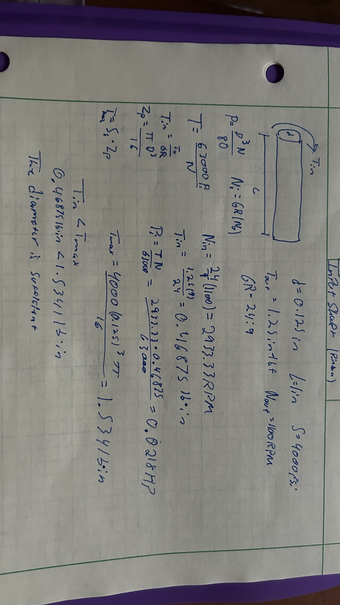
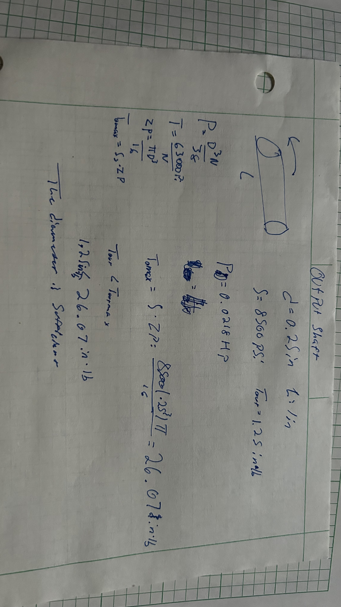
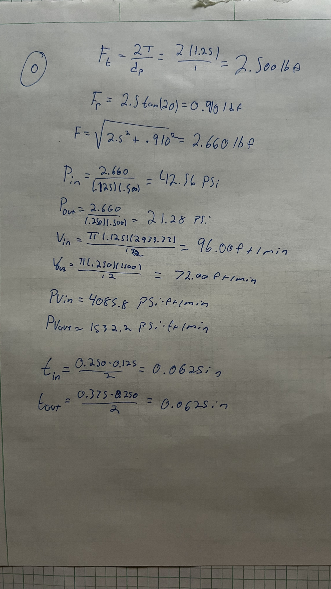
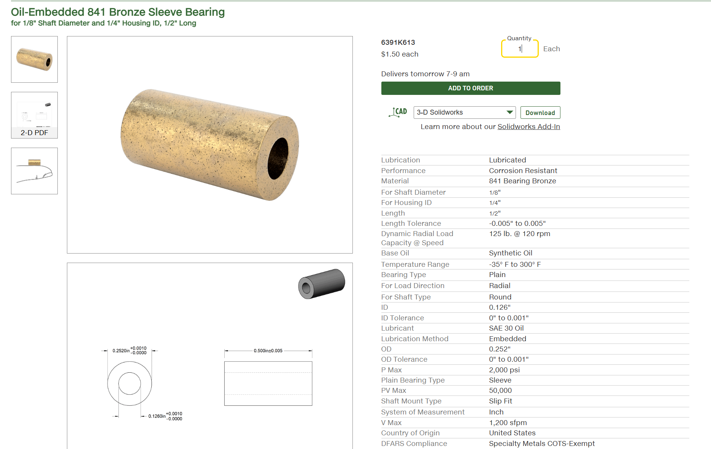
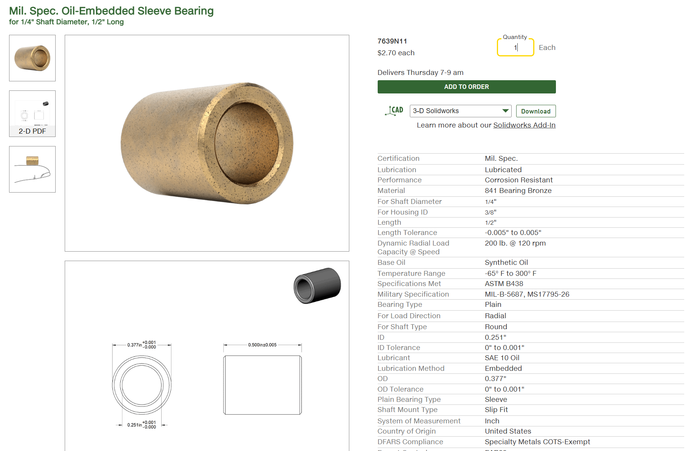

# A8 – Gears

## Objective

The objective of this assignment is to design a gearbox with spur gears, designing a journal bearing to use, and model these items in solidworks. 

## Analyze

The output gear torque and speed are to be 1.25 in-lbf and 1100 rpm. The input (pinion) shaft diameter is 0.125 inches, the output shaft has a diameter of 0.25 inches. They both have a length of 1 inch. The gear ratio is 24:9.

Assumptions-Assume appropriate strength of shafts, use Machinery’s Handbook. The gear train is ideal. The moment of the radial force from the gear train is small enough to be ignored. 

Note- The shafts are press fit through the hubs of the gears. Make sure there is enough clearance between the gears and the gearbox. Use a running sliding fit for the size of the hole for the shafts.

For my shaft calculations I used the machinery's handbook to find the allowable stresses generally used in practice which are 4000 pounds per square inch for main power-transmitting shafts; and 8500 pounds per square inch for small, short shafts. 

I began with the shafts. I was tasked to check if the diameter was sufficient. The input shaft was first since it was first in the assignment instructions.

The diameter was sufficient, no new recommended diameter. I will now check the output shaft.

The diameter of the output shaft is also sufficient. Now we will design and choose a journal bearing. 

To choose a journal bearing we have to find the allowable PV so we can properly select a thickness and material. 

I will now use these values to select the journal bearings. For the input bearing I have chosen [6391K613](https://www.mcmaster.com/6391K613/) and for the output bearing I chose [7639N11](https://www.mcmaster.com/7639N11/) since they meet the requirements I calculated. 

## Decide

## Communicate

