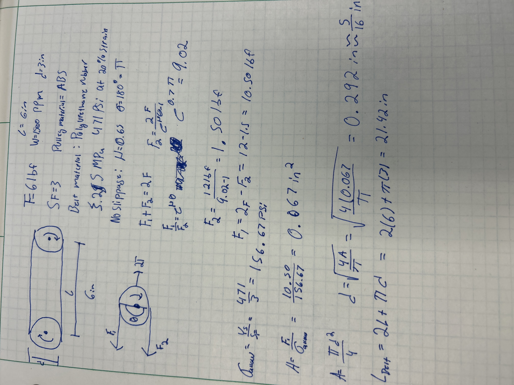
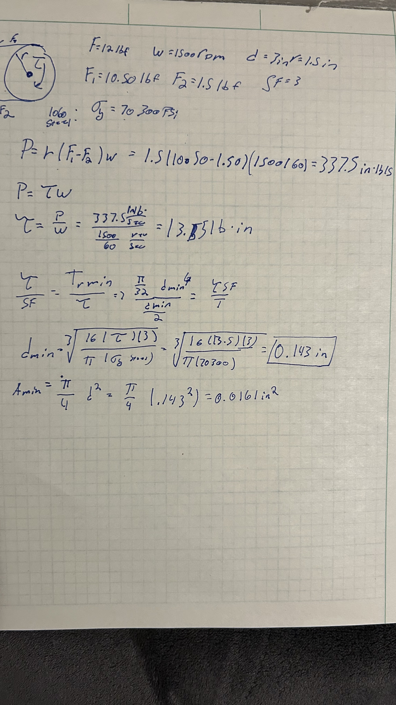

# A9 – Pulleys

## Objective

The objective of this assignment is to design a pulley system to transfer power between two parallel axes. Both pulleys have a diameter of 3 inches, the center distances are 6 inches apart, the operating speed is 1500 rpm, the belt tensions is 6 lbf under stationary conditions, and the pulleys are made out of ABS (30 MPa, 4300 psi). The belt is made out of polyurethane rubber with a yield strength of 3.25 MPa (471 psi) at 20% strain. The design must satisfy a safety factor of 3. 

## Analyze

To begin we have to calculate the belt dimensions to choose a belt that fits. We will find the diameter and length of the belt.

I found the coefficient of friction to be 0.65 for polyurethane rubber on ABS. I was going to originally choose a 5/16 in diameter but when looking on McMaster-Carr there was no option for a 5/16 in diameter and a circumference of 21.42 in. Realizing this I decided to choose a belt with a 21 1/2 in circumference and a slightly larger diameter of 3/8. [3044K608.](https://www.mcmaster.com/3044K608-1835T915/) 

Next, I found the minimum diameter for the shaft. I looked up the yield strength for 1060 hardened steel and got the value of 70,300 psi. The minimum diameter was 0.143 in. 

## Decide

## Communicate

