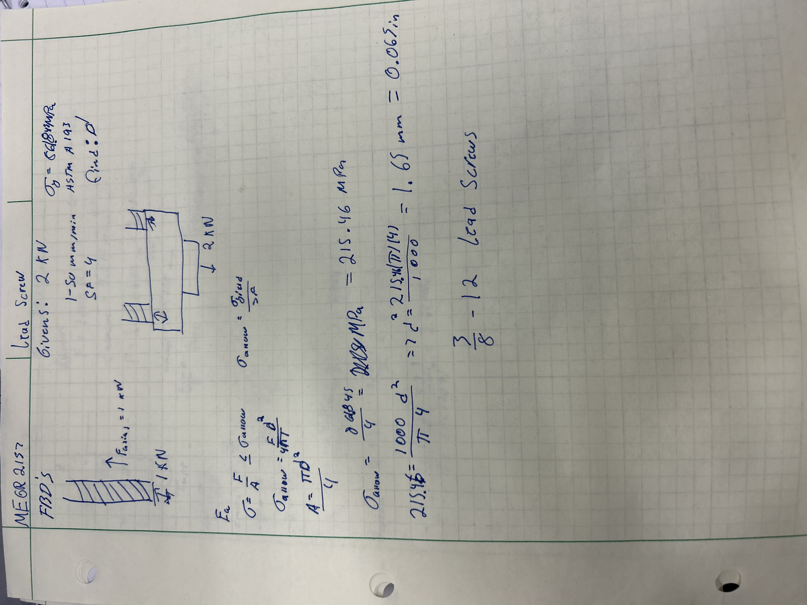
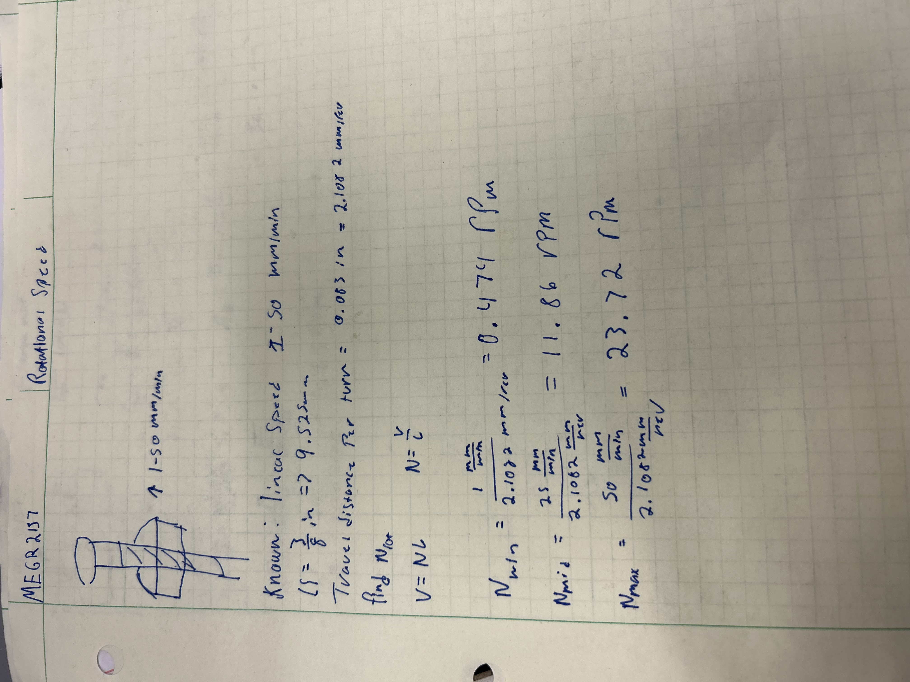
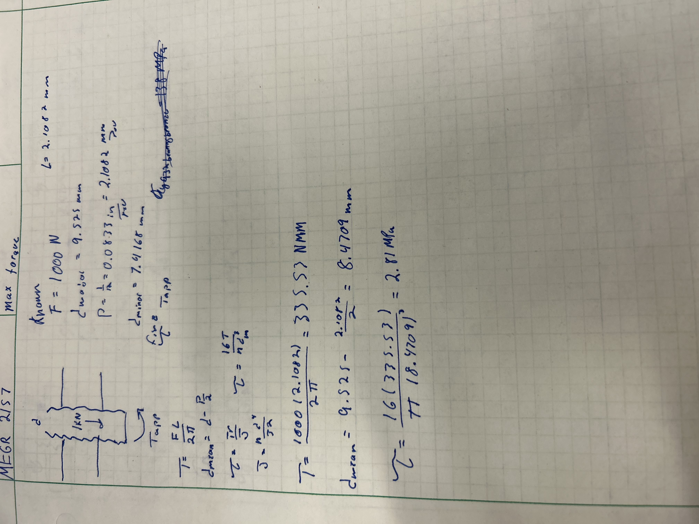
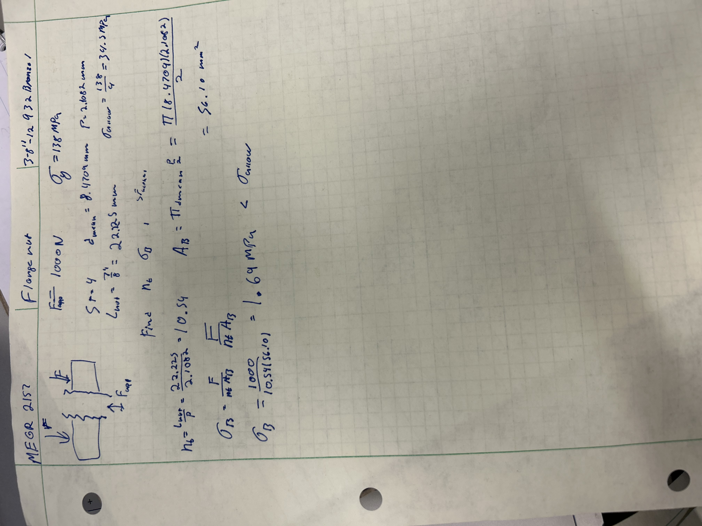
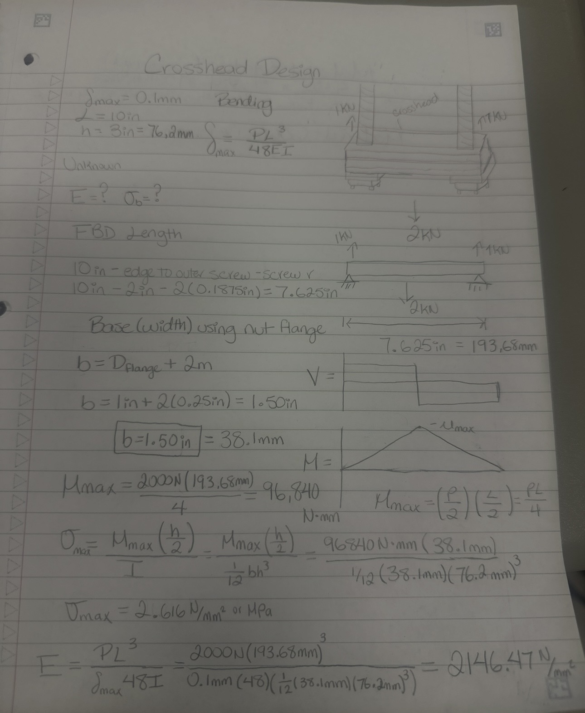
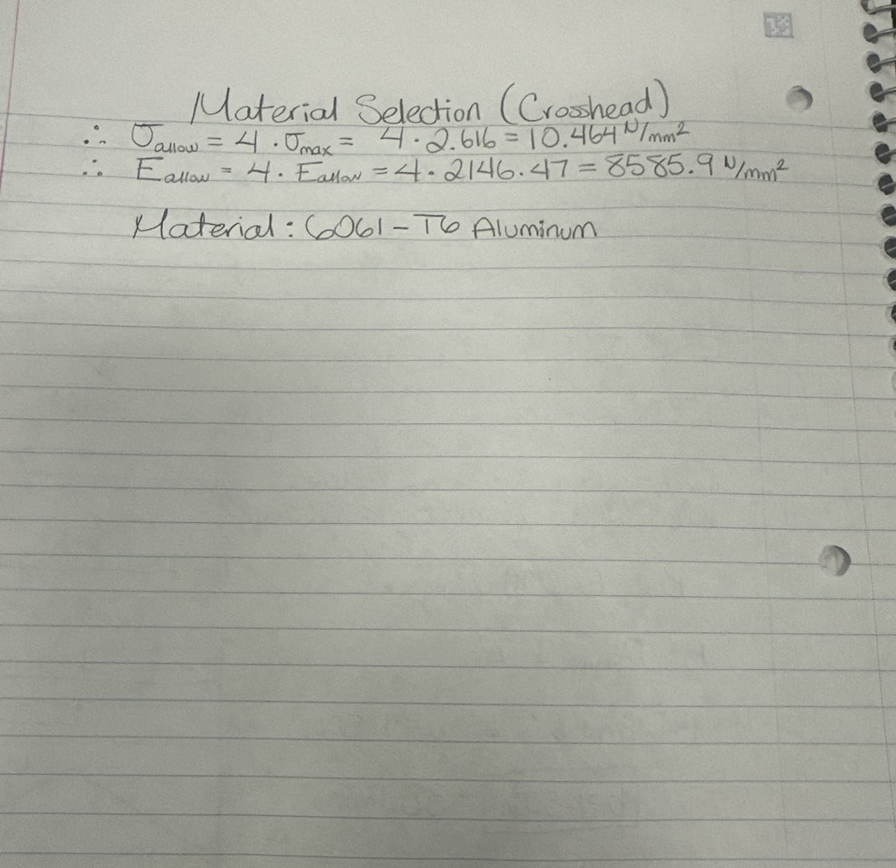

# A10 – Lead Screw Translating System

## Objective

The objective for this assignment was to design a tensile tester. We will design a leadscrew driven crosshead and choose the leadscrew and nut. It will apply a 2kN axial tensile load with a controllable speed of 1-50 mm/min. The assignment is divided into individual tasks between our team of three. 
## Analyze

### Leadscrew diameter- Jonathan

#### Minimum diameter due to axial stress-

To begin I calculated the minimum diameter of the screw. I used the yield stress value of 861.845 mPa for ASTM A193, a safety factor of 4, and an axial load of 1kN. The calculated value was 0.065 in, while viewing 18" lead screws on McMaster-Carr there was no ASTM A193 leadscrews. I decided to go with [93410A111](https://www.mcmaster.com/93410A111/)

#### Rotational Speed-

Next I calculated the range of the rotational speed the leadscrew will have with the values of 1 mm/min, 25mm/min, and 50 mm/min.

#### Leadscrew torque

I then calculated the torque and shear forces on the leadscrew.

### Selecting a nut and flange- Jonathan

I calculated the stress in the nut(https://www.mcmaster.com/95120A592/) that was compatible with the leadscrew, and found that the stress was less than the allowable stress so it was found suitable for the task. 

## Crosshead Design- Jeffrey

After multiplying the calculated modulus of elasticity and bending stress for the crosshead it was decided that the material for the crosshead would be 6061-T6 Aluminum. Both the yield strength and the modulus of elasticity of the material is several times higher to what was calculated for the crosshead.

### Tabulating Costs- Jeffrey 

| Item Number | Quantity | Name | Cost/Item | Total Cost | Purchase Link |
|  :--- | :--- | :--- | :---| :--- | :---|
| 1 | 2 | 18-8 Stainless Steel Acme Lead Screw, Right Hand, 3/8"-12 Thread Size, 2 Feet Long | $57.73 | $115.46 | [Product](https://www.mcmaster.com/93410A111/)| 
| 2 | 2 | 932 Bearing Bronze Acme Flange Nut, Right Hand, 3/8"-12 Thread Size | $111.78 | $223.56 | [Product](https://www.mcmaster.com/95120A592/) |
| 3 | 1 | Crosshead (Multipurpose 6061 Aluminum Bar, 3" Thick x 3" Wide x 1 Foot Long) | $136.42 | $136.42 | [Product](https://www.mcmaster.com/9008K62-9008K621/?s=rectangular+bar) |
| 4 | |  | |  |  |

## Decide
_Reference your concept selection (Pugh matrix) here. How does this design follow from that decision?_

## Communicate

Jonathan- I learned how to model equations to choose a leadscrew. Working as a group to finish this assignment taught me to be mindful of doing my work earlier so my teammates would not get behind on their sections. My section and documentation took around 4 hours. 

