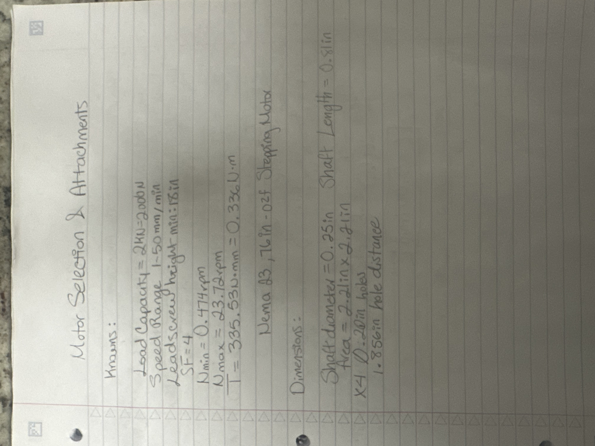
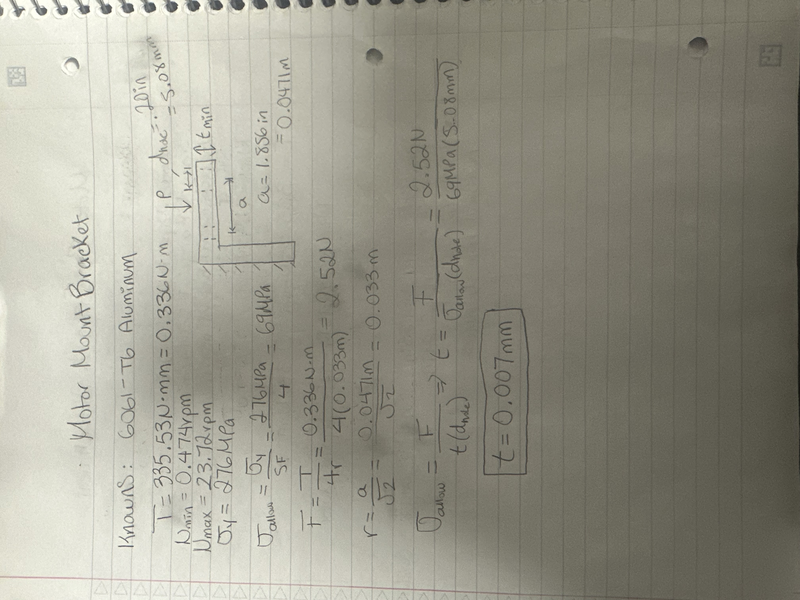
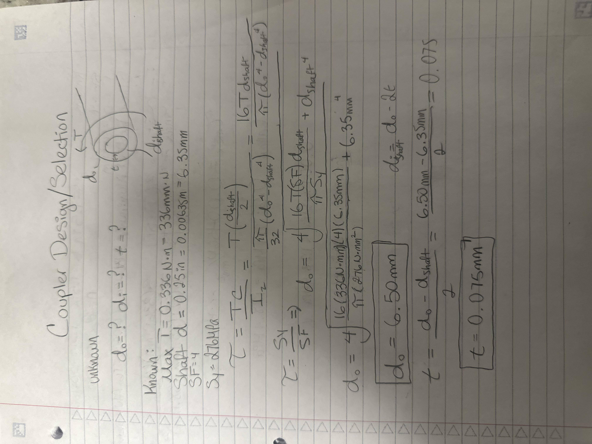
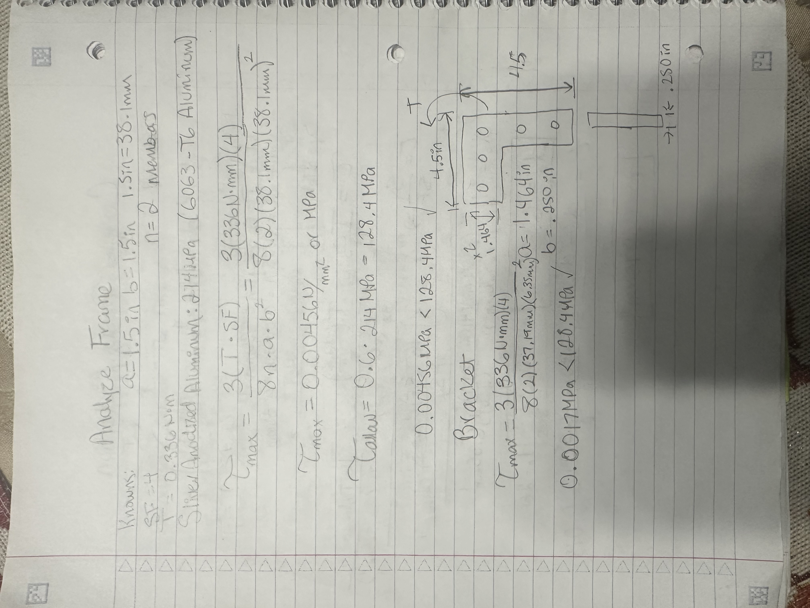
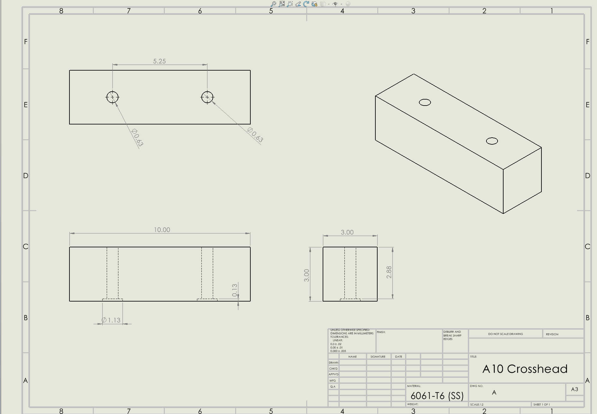
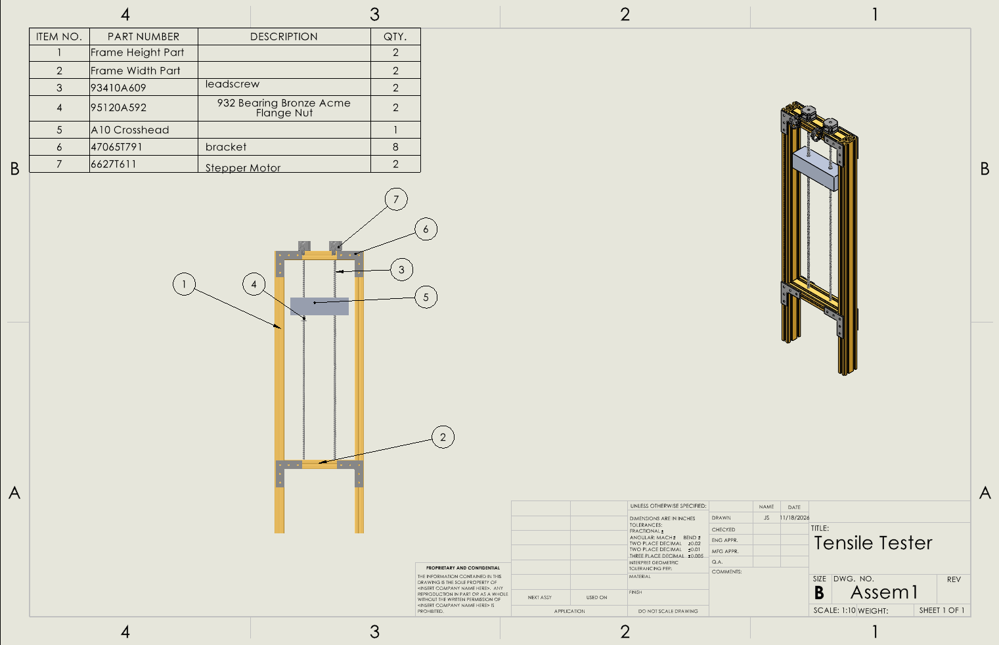

 # A11 – Motor Selection

## Objective

Develop the motorized drive and structural integration for the 2 kN tensile tester, focusing on motor selection, mounting, frame stability, and clamp design. This phase will ensure that the crosshead moves smoothly under controlled torque and speed while maintaining precise load alignment and secure specimen gripping.

## Motor Selection- Jeffrey

The Nema 23- 76in-oz Maximum Holding Torque was chosen as it is several times above the max torque. Additionally, according to the speed vs torque graph the motor can withstand both the max speed and the max torque. Also, this one was selected compared to the Nema 23 73in-oz because it is half the price due to more wiring, but it is sturdier. 

## Motor Mount Bracket- Jeffrey

After designing for the thickness of the motor mount I went to McMaster to look for a motor mount for the frame size of Nema 23, but there was none. Therefore, after further research I found some nema 23 motor mounts on Amazon sold by the [STEPPERONLINESTORE](https://www.amazon.com/stores/STEPPERONLINE/page/CC42C048-C998-462F-9C8C-189225C4412C?lp_asin=B00Q6GIO5K&ref_=ast_bln&store_ref=bl_ast_dp_brandlogo_sto).

## Coupler Design/Selection- Jeffrey

A rigid shaft coupling was selected because compared to flexible shaft couplings the rigid shaft coupling can handle higher torques, the catch though is the shafts, must be aligned.

## Analyze and Design Frame Connector- Jeffrey

First, I looked at corner brackets on McMaster to find one that would fit the width of the rails, I only found one with a length of 4.5in there it would cover almost the whole length of the tensile tester with 2 brackets on each long side. Afterwards I checked that it would be safe to use and it was several, several times higher than the forces.

## FEA Top Frame

## FEA Vertical Components

## Design Floating Bearing Mount

## Bills of Materials and Labor Costs

| Item Number | Quantity | Name | Cost/Item | Total Cost | Purchase Link |
|  :--- | :--- | :--- | :---| :--- | :---|
| 1 |  2 | Set Screw shaft coupling | $13.60 | $27.20 | [Product](https://www.mcmaster.com/2424K11/) | 
| 2 | 8 | Black Flush 90 degreee bracket for 1.5" High Rail T-Slotted framing | $23.43 | $187.44 | [Product](https://www.mcmaster.com/47065T791/) |
| 3 | 2 | Stepper Motor | $64.79 | $129.58 | [Product](https://www.mcmaster.com/6627T611/) |
| 4 | 3 | T-slot Framing | $264.97 | $794.91 | [Product](https://www.grainger.com/product/80-20-T-Slot-Framing-System-Rectangle-804T48) |
| 5 | 2 | Alloy Steel Acme Lead Screw | $57.73 | $115.46 | [Product]() |
| 6 | 2 | 932 Bearing Bronze Acme Flange Nut, Right Hand, 3/8"-12 Thread Size | $111.78 | $223.56 | [Product]() |
| 7 | 1 | Multipurpose 6061 Aluminum Bar, 3" Thick x 3" Wide x 1 Foot Long (Crosshead) | $136.42 | $136.42 | [Product]() |

Material Cost: $1614.57

| Name | Total Hours | Rate | 
|  :--- | :--- | :--- |
| Jonathan Suarez | 7 | $35 |
| Jeffrey Mendoza | 10 | $35 |
| Landyn Sherill | 15 | $35 |

Labor Cost: 

Total Cost: 

## Engineering Lesson

Jeffrey- From my sections for this assignment I learned how to select a motor based on the minimum and maximum speed, as well as the max torque. Additionally, I learned more about the components in a tensile tester, like the shaft coupler. I learned how to approximately select a shaft coupler similar to selecting a motor, based on speed and torque. The time it took to complete my sections for this assignment took me approximately 6 hours including reading and documentation.

Jonathan- This section taught me how to calculate the costs of a project. I also learned how to make an assembly drawing with a bill of materials list. This section took me about 3 hours

## 2157

## Decide
_Reference your concept selection (Pugh matrix) here. How does this design follow from that decision?_

## Communicate
